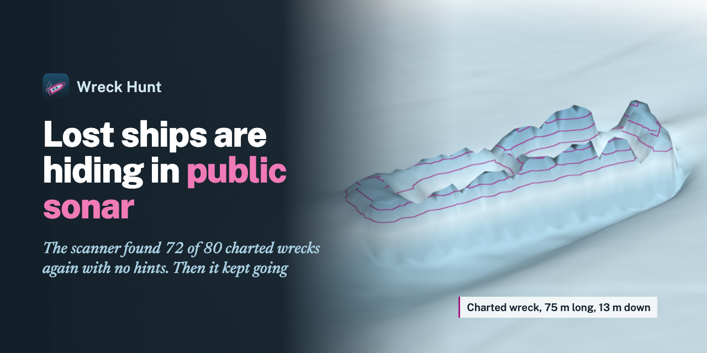
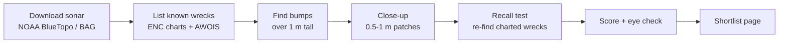

<p align="center"></p>

# Wreck Hunt

Find shipwrecks nobody has charted, in sonar maps the public already paid for.

**Live board: https://wreckhunt.techguyverlabs.org**

NOAA, NCEI and AusSeabed publish seabed depth maps (multibeam sonar, 0.5 to 4 m per pixel).
Wreck Hunt scans them for every hard, ship-sized bump, removes everything already on a
nautical chart or in the old wreck lists, and ranks what is left. You then look at every
lead in 3D, side by side with real wrecks at the same scale, and keep or drop it.

First area, Chesapeake Bay mouth: 2,440 km² scanned, 72 of the 80 charted wrecks in the
sonar found again with no hints, 10 uncharted leads on the shortlist.



## Try it in 1 minute (no downloads)

```sh
git clone https://github.com/royherma/wreck-hunt && cd wreck-hunt
node server.mjs            # Node 20+, no npm install
```

Open http://localhost:5027. With no hunt run yet the page shows the built-in **Sample**:
made-up seabed with planted hulls, so you can try every view (3D, compare, profiles, scores).

## Run a real hunt

```sh
python3.12 -m venv .venv && .venv/bin/pip install -r requirements.txt
```

Every script reads the area from `AREA=<key>` (see `bin/areas.py`) and writes to
`data/<area>/` (downloads) and `out/<area>/` (results). Order:

| Step | Script | What it does |
| --- | --- | --- |
| 1 | `bin/getbag.py`, `bin/fetch-tiles.sh` | Download the sonar (BAG files or BlueTopo tiles) |
| 2 | `bin/known.py`, `bin/known_enc.py` | Known wrecks from NOAA charts (ENC) and AWOIS |
| 3 | `bin/scan.py` or `bin/bagscan.py` | Every bump over 1 m tall, minus charted ones |
| 4 | `bin/fine.py`, `bin/localpatch.py` | Sharp close-up of each bump |
| 5 | `bin/recall.py`, `bin/implant.py` | Proof it works: re-find charted wrecks, or plant fake hulls |
| 6 | `bin/rank.py`, `bin/edges.py` | Score each lead (jagged, scour, steep sides, straight edges) |
| 7 | `bin/export.py` | Write the board data to `out/web/<area>/` |
| 8 | `bin/missing.py` | Lost ships in the area with no known position |

Example: `cd bin && AREA=bayfield ../.venv/bin/python -W ignore scan.py`

Sizes: a 0.5 m survey is 1-3 GB; the Chesapeake run used 9 GB of sonar.

## The pages

| Page | For |
| --- | --- |
| `/` Shortlist | The best leads, each with a 3D close-up, profile and score that explains itself |
| `/all.html` | Every close-up, filters, Keep / Drop / Unsure (keys K / X / U) |
| `/all.html#compare=...` | Up to 12 side by side at true scale: pictures, 3D, outlines, profiles, facts |
| `/map.html` | Every lead against every known wreck (local only, see below) |
| `/lost.html` | Ships lost in the area with no known position, and which lead fits by size |

## Positions stay private

Exact positions never leave your machine. Anything precise lives in `out/<area>/private/`
and is only served to `localhost` (`/api/where`, `/api/map`, `/api/patch`). The public board
data (`out/web/`) carries a 5 km cell and a sentence like "about 10 km south-east of Cape Henry".

Why: wrecks are often war graves, protected sites or both. In US waters the Abandoned
Shipwreck Act gives most wrecks to the state, and inside marine sanctuaries disturbing one
is a federal offence. Finding is legal. Disturbing is not. Report a real find to the state
historic preservation office or NOAA, not to the internet.

## Publish the board

```sh
npm run build:public      # writes dist/: pages + board data, no private folders
npx wrangler pages deploy dist --project-name wreck-hunt
```

The build drops the local-only pages (map, live build, case files), puts every uncharted
lead in a 20 km square (`PUBLIC_CELL_KM` to change it), rounds depths to 5 m, and fails if a
file is over Cloudflare's 25 MiB limit or a `private` folder slipped in. `AREAS=a,b` ships
only some areas.

## Add an area

1. Add an entry to `AREAS` in `bin/areas.py` (name, bounding box, chart cells, UTM zone).
2. Run the steps above with `AREA=<key>`.
3. It shows up in the area menu on every page.

Ranked candidate areas: `docs/next-regions.md`.

## Where this is going

A scan network: anyone runs one command, their computer scans a sonar tile nobody has
scanned yet, a second computer checks it, and the close-ups land on a shared public board
where people vote Keep / Drop. Plan and phases: `docs/scan-network.md`.

## Help wanted

- One command per area (`bin/hunt.sh <area>`) instead of 8 scripts run by hand
- A straight-edge / right-angle test strong enough to tell hulls from rock reef
- More areas outside the US (AusSeabed, EMODnet, UK Hydrographic Office)

See `CONTRIBUTING.md`.

## License

MIT, see `LICENSE`. Sonar and chart data belong to their publishers (NOAA, NCEI,
AusSeabed) and keep their own terms.
