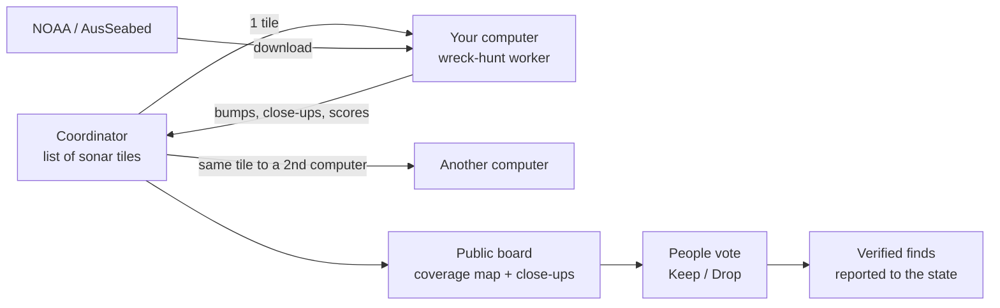

# Scan network: everyone's computer looks for lost ships

Goal: anyone runs one command, their computer scans a piece of seabed nobody has scanned yet,
and the results land in one shared map of what has been searched and what was found.

## Where the time goes today (Chesapeake, Bayfield, Victoria runs)

| Stage | Cost | Who can do it |
| --- | --- | --- |
| Download sonar | 1-9 GB per area | Any computer, straight from NOAA |
| Scan + close-ups | hours of CPU per area (measure per 100 km² before quoting) | Any computer |
| Eye check | Bayfield 41 judged, 0 ship-like; Victoria 24 judged, all reef | People |

The scan is easy to spread out. The real bottleneck is the eye check: most bumps are rock,
so the network has to share the looking, not only the CPU.



## The pieces

1. **Work unit = one sonar tile** (a BlueTopo tile or one BAG survey file): id, download URL,
   checksum, area, scanner version. Small enough to finish in under an hour on a laptop.
2. **Worker** `wreck-hunt worker`: asks for a tile, downloads it from the publisher (no
   bandwidth cost to us), runs steps 3-6, uploads the result (a few MB: bump list, close-up
   heightfields, scores), deletes the sonar. Pinned Python versions so two computers give the
   same answer.
3. **Checking**: every tile goes to 2 computers; results must match. Charted wrecks inside
   the tile are a free test: a worker that misses them gets its results re-run.
4. **Coordinator**: a Cloudflare Worker + D1 (tiles, results, who did what) + R2 (close-ups).
5. **Shared looking**: every close-up on the public board gets Keep / Drop / Unsure from
   anyone signed in; a lead needs several keeps from different people to reach the shortlist.
6. **Leaderboard**: km² scanned, close-ups judged, finds confirmed, per person.

## Sharing: results go straight to the board, the finder decides who sees the spot

Updated 12 Nov 2026. Replaces "one pull request per area": a PR per scan puts a maintainer
between every contributor and the board, and that does not scale past a handful of people.
Pull requests are for code only.

```
your computer                    coordinator (Worker + D1 + R2)          public board
-------------                    ------------------------------          ------------
wreck-hunt hunt <area>
  scan + close-ups
  recall on charted wrecks  ---> machine checks, no human:
wreck-hunt share                   - recall >= 80% on charted wrecks
  close-ups, sizes, scores         - same tile on a 2nd computer agrees  --> live within minutes
  exact spot (encrypted)           - stamp: finder + time + version          close-ups, finder name,
                                   - exact spot stored, never public        20 km square, time
                                                                                  |
                                                                    people vote Keep / Drop
                                                                                  |
                                                        shortlist --> state office + NOAA (auto)
                                                                  --> divers / ROV the finder lets in
```

| Who | Sees | Why |
| --- | --- | --- |
| Everyone | Close-up, size, score, finder, time, 20 km square | Judge it, credit the finder |
| The finder | Exact spot of their own leads | It is theirs |
| People the finder lets in | Exact spot | A dive club or ROV team checks it |
| State archaeologist + NOAA | Exact spot of every shortlisted lead, sent automatically | They own the wreck by law; it also makes the find official |
| Everyone, later | Exact spot of a lead the state has confirmed and cleared for publishing | It is on the chart by then anyway |

- **Credit is the reward.** The coordinator stamps finder + time when a lead first arrives, so
  the first person to find something keeps it, even if a second computer later finds it too.
  First-finder name stays on the lead, the leaderboard and the state report.
- **Pay it forward.** Running `wreck-hunt share` also takes one unscanned tile from the queue and
  scans it before your own results upload: every share leaves the map bigger for the next person.
- **Nobody approves a scan.** Bad results are caught by the machine checks above; a worker that
  misses charted wrecks in its tile is re-run elsewhere and its leads stay hidden.
- **Why the spot stays off the open board:** in state waters a historic wreck belongs to the state
  (Abandoned Shipwreck Act) and disturbing one without a permit breaks the law in Virginia and
  Wisconsin. An open map of exact uncharted spots is the thing that gets a project like this shut
  down. The sonar is public, so this is a speed bump, not a lock: it keeps the board from being
  a ready-made dive map.

| Open to everyone (CC BY) | Kept to finder, invited checkers, state, NOAA |
| --- | --- |
| Which tiles were scanned, by which version, by whom | Exact spot of uncharted leads until the state clears it |
| Every charted wreck the scanner found (a benchmark set) | |
| Every close-up (shape, size, score), finder, time, 20 km square | |
| All votes and the reason for every score | |

## Phases

| Phase | Ships | Done when |
| --- | --- | --- |
| 0 | Open-source repo + public board (this repo) | A stranger runs the Sample from a clone |
| 1 | `wreck-hunt hunt <area>`: one command, resumes | A stranger finishes an area with no help |
| 2 | Coordinator + `wreck-hunt share` + machine checks + first-finder stamp | 10 computers share results with no maintainer step |
| 3 | Shared Keep / Drop on the public board | 1,000 close-ups judged by people other than us |
| 4 | Auto report to state offices + finder invites checkers | First find confirmed by someone with a boat or an ROV |

## Words on the public site

Say "lost ships" and "shipwrecks", not "treasure". Wrecks are history and often graves,
most belong to the state, and treasure talk draws exactly the people the private positions
are there to keep out.
