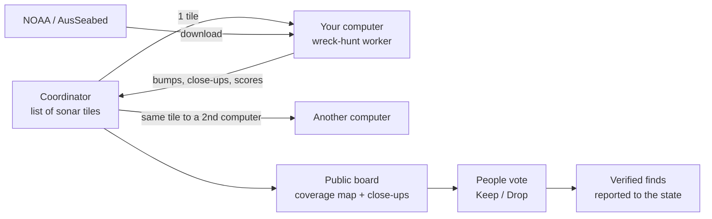

# Scan network: everyone's computer looks for lost ships

Goal: anyone runs one command, their computer scans a piece of seabed nobody has scanned yet,
and the results land in one shared map of what has been searched and what was found.

## Where the time goes today (Chesapeake, Bayfield, Victoria runs)

| Stage | Cost | Who can do it |
| --- | --- | --- |
| Download sonar | 1-9 GB per area | Any computer, straight from NOAA |
| Scan + close-ups | hours of CPU per area (measure per 100 km² before quoting) | Any computer |
| Eye check | Bayfield 41 judged, 0 ship-like; Victoria 24 judged, all reef | People |

The scan is easy to spread out. The real bottleneck is the eye check: most bumps are rock,
so the network has to share the looking, not only the CPU.

## The pieces

1. **Work unit = one sonar tile** (a BlueTopo tile or one BAG survey file): id, download URL,
   checksum, area, scanner version. Small enough to finish in under an hour on a laptop.
2. **Worker** `wreck-hunt worker`: asks for a tile, downloads it from the publisher (no
   bandwidth cost to us), runs steps 3-6, uploads the result (a few MB: bump list, close-up
   heightfields, scores), deletes the sonar. Pinned Python versions so two computers give the
   same answer.
3. **Checking**: every tile goes to 2 computers; results must match. Charted wrecks inside
   the tile are a free test: a worker that misses them gets its results re-run.
4. **Coordinator**: a Cloudflare Worker + D1 (tiles, results, who did what) + R2 (close-ups).
5. **Shared looking**: every close-up on the public board gets Keep / Drop / Unsure from
   anyone signed in; a lead needs several keeps from different people to reach the shortlist.
6. **Leaderboard**: km² scanned, close-ups judged, finds confirmed, per person.

## What is open and what is not

| Open to everyone (CC BY) | Kept back |
| --- | --- |
| Which tiles were scanned, by which version | Exact position of uncharted leads |
| Every charted wreck the scanner found (a benchmark set) | |
| Every close-up (shape, size, score), placed in a 20 km square | |
| All votes and the reason for every score | |

Exact positions go to state archaeologists and NOAA on request. This is a speed bump, not a
lock: the sonar is public and anyone can run the scanner. It stops the board from being a
ready-made dive map for looters, which is what gets a project like this shut down.

## Phases

| Phase | Ships | Done when |
| --- | --- | --- |
| 0 | Open-source repo + public board (this repo) | A stranger runs the Sample from a clone |
| 1 | `bin/hunt.sh <area>`: one command, resumes | A contributor adds an area by PR (board data only) |
| 2 | Coordinator + `wreck-hunt worker` + double checking | 10 computers finish one new area |
| 3 | Shared Keep / Drop on the public board | 1,000 close-ups judged by people other than us |
| 4 | Report path to state offices | First find confirmed by someone with a boat or an ROV |

## Words on the public site

Say "lost ships" and "shipwrecks", not "treasure". Wrecks are history and often graves,
most belong to the state, and treasure talk draws exactly the people the private positions
are there to keep out.
